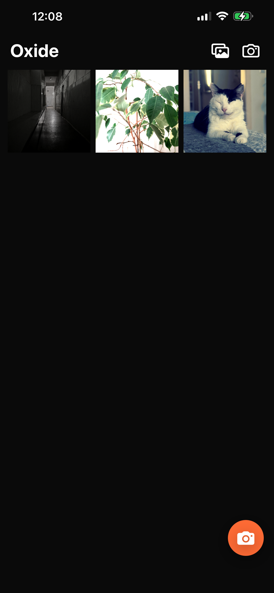
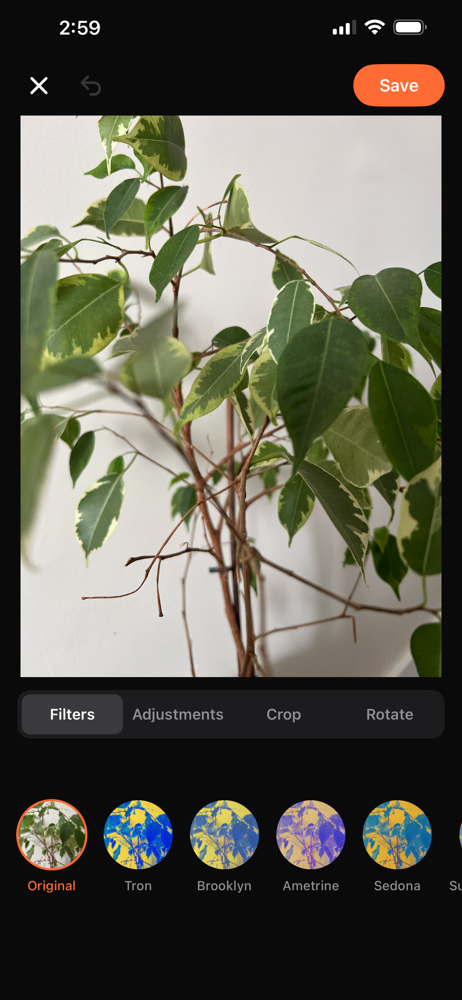
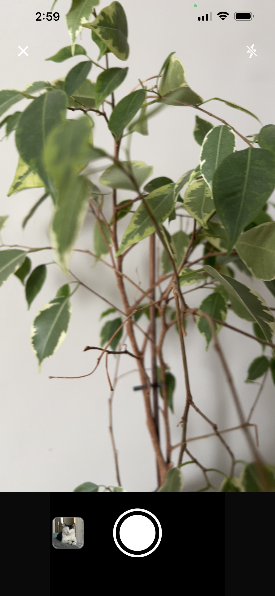

# Oxide

Oxide is a nondestructive photo editor for iPhone built with SwiftUI, Core Image, and Metal. It combines an in-app camera and photo library with LUT-based color grading, detailed tonal controls, reusable looks, precision cropping, and a growing collection of creative effects. The project is also a production-minded reference for modular VIPER architecture, Swift 6 concurrency, and responsive high-resolution image processing.

> The project is under active development. APIs and persisted edit metadata may evolve.

## Highlights

- Front and rear camera capture with flash, torch, focus, exposure, and zoom controls
- Photo-library import, an on-device gallery, full-resolution export, and the native iOS share sheet
- LUT-based color grading with filter packs and adjustable intensity
- Nondestructive crop and rotation with edge handles and common aspect ratios
- Automatic enhancement plus exposure, contrast, highlights, shadows, whites, blacks, temperature, tint, vibrance, saturation, brightness, sharpness, and monochrome controls
- Creative effects spanning film texture, light and glow, lens treatments, focus and blur, distortion, and stylized transformations
- Positionable effect masks for localized effects
- Reusable looks that preserve a complete editing recipe
- Pinch, pan, double-tap, press-to-compare, and button-based editor preview controls
- Undo history for editing operations
- Proxy-based previews and Metal-backed Core Image rendering for responsive high-resolution editing
- Swift 6 concurrency, actor-isolated persistence, and Swift Package Manager modularization

## Screenshots

| Gallery | Editor | Camera |
| :---: | :---: | :---: |
|  |  |  |

## Architecture

The app uses VIPER at the feature level and SPM targets for module boundaries:

```text
Oxide (app target)
└── OxideModules
    ├── Root
    ├── Home
    ├── Gallery
    ├── Editor
    ├── ImageProcessor
    ├── Onboarding
    ├── Settings
    ├── Splash
    ├── AppCore
    └── UIComponents
```

At the feature level, SwiftUI Views render presenter state, Presenters coordinate user intent, Interactors own application logic and adapt reusable services, and Routers own navigation and system presentation. `Gallery` manages capture, import, browsing, export, and sharing, while the dedicated `Editor` module owns editing state, history, reusable looks, and tool presentation. `ImageProcessor` provides the independent capture and rendering infrastructure through a shared Metal-backed `CIContext`.

### Reusing ImageProcessor

`ImageProcessor` is independent from Gallery and organized as a portable subsystem:

```text
ImageProcessor/
├── Capture/       Camera session, authorization, preview, and configuration
├── Processing/    Edit recipes, adjustments, effects, LUTs, rendering, export
└── Store/         Image files, Photos export, and actor-isolated edit history
```

Client applications keep their own photo models and conform them to `ImageProcessingSource`:

```swift
struct ProjectPhoto: ImageProcessingSource, Sendable {
    let imageSourceURL: URL
    let imageEditRecipe: ImageEditRecipe
}

let outputURL = try await ImageExportService()
    .exportJPEG(from: projectPhoto, filename: "edited-photo")
```

Camera capture is configured without Gallery dependencies:

```swift
let camera = CameraSessionController(
    configuration: CameraCaptureConfiguration(position: .back)
)
```

### LUT assets

The image-processing engine and LUT integration are open source, but the
proprietary LUT image assets shown in the screenshots are intentionally not
distributed. A clean clone runs with the Original preset and the rest of the
editor functionality intact. Developers can add LUT resources they own to
`OxideModules/Sources/ImageProcessor/LUTs/`; that directory is excluded from
Git apart from its setup notice.

Project maintainers with access to the private asset repository can install the
official LUT set with:

```sh
./Scripts/install-luts.sh
```

The command clones `mentalparalyse/Oxide-LUTs` using the developer's existing
GitHub credentials and copies its PNG resources into the ignored LUT directory.
It also accepts an existing checkout, which avoids another network fetch:

```sh
./Scripts/install-luts.sh /path/to/Oxide-LUTs
```

### Private effects

The production effect renderer is maintained in the private
`mentalparalyse/Oxide-Effects` repository. A public clone does not contain or
download that implementation. Without it, `ImageProcessor` remains buildable
and effect recipes pass images through unchanged.

Maintainers with repository access can install the private package with:

```sh
./Scripts/install-effects.sh
```

The ignored checkout is placed at `Oxide-Effects/` and Swift Package Manager
links it automatically on the next package resolution. An existing checkout
can be installed without another network fetch:

```sh
./Scripts/install-effects.sh /path/to/Oxide-Effects
```

### Private analytics

Analytics collection and validation are maintained in the private
`mentalparalyse/Oxide-Analytics` repository. The complete `AnalyticsCore`
module—including its event contract—is absent from a public clone. Conditional
integration points compile out when the private package is unavailable, so a
public build neither records nor uploads analytics.

Maintainers with repository access can install the private package with:

```sh
./Scripts/install-analytics.sh
```

The ignored checkout is placed at `Oxide-Analytics/`, matching the private
effects integration. Swift Package Manager links it automatically on the next
clean package resolution. An existing checkout can be installed without
another network fetch:

```sh
./Scripts/install-analytics.sh /path/to/Oxide-Analytics
```

Set `OXIDE_DISABLE_PRIVATE_ANALYTICS=1` when validating the public fallback.

## Requirements

- Xcode 17 or newer
- Swift 6.1 or newer
- iOS 16 or newer
- A physical iPhone for camera and torch testing

## Getting started

1. Clone the repository.
2. Open `Oxide.xcodeproj` in Xcode.
3. Select the `Oxide` scheme and a signing team.
4. Build and run.

The app already declares camera, photo-library read, and photo-library add usage descriptions in `Oxide/Info.plist`.

## Tests

Run the package tests from Xcode, or from the repository root:

```sh
swift test --package-path OxideModules
```

Camera and Photos authorization flows still require device-level verification because the corresponding Apple frameworks are not fully represented by unit tests.

## Performance notes

- A reusable Metal-backed `CIContext` avoids repeated GPU setup.
- LUT cube data is cached and previews are prepared with bounded concurrency.
- Full-resolution rendering and image encoding run away from the main actor.
- Camera configuration and session operations are serialized on a dedicated queue.
- Thumbnail rendering is pixel-bounded to reduce decode cost and memory pressure.

## Contributing

Issues and focused pull requests are welcome. Please keep business logic out of SwiftUI Views, include tests for behavior changes, and preserve the module boundaries described above.

## License

Oxide is available under the MIT License. See [`LICENSE`](LICENSE).
